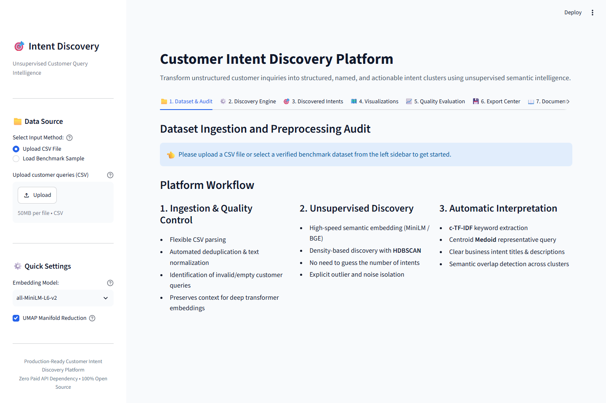
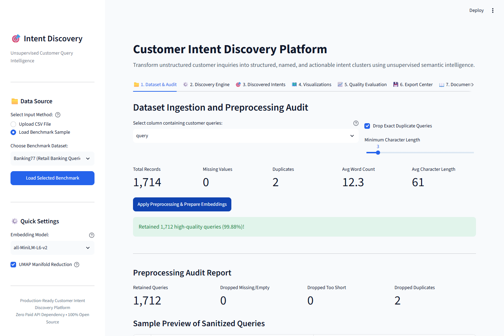
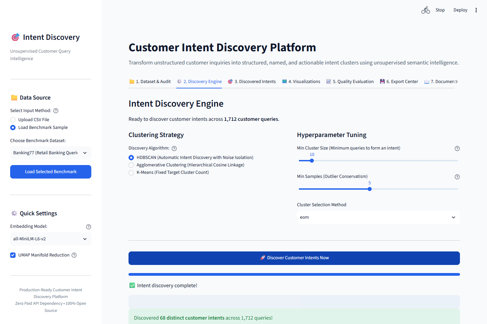
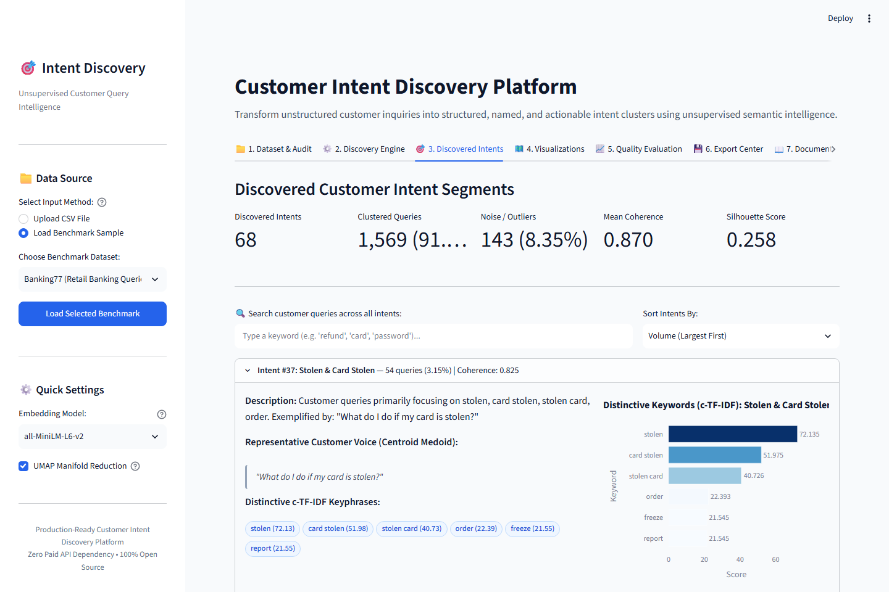
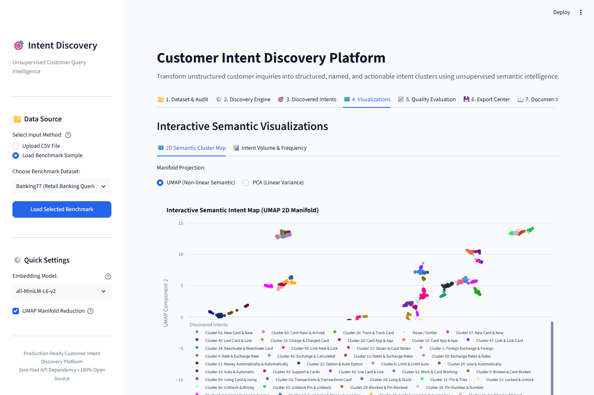
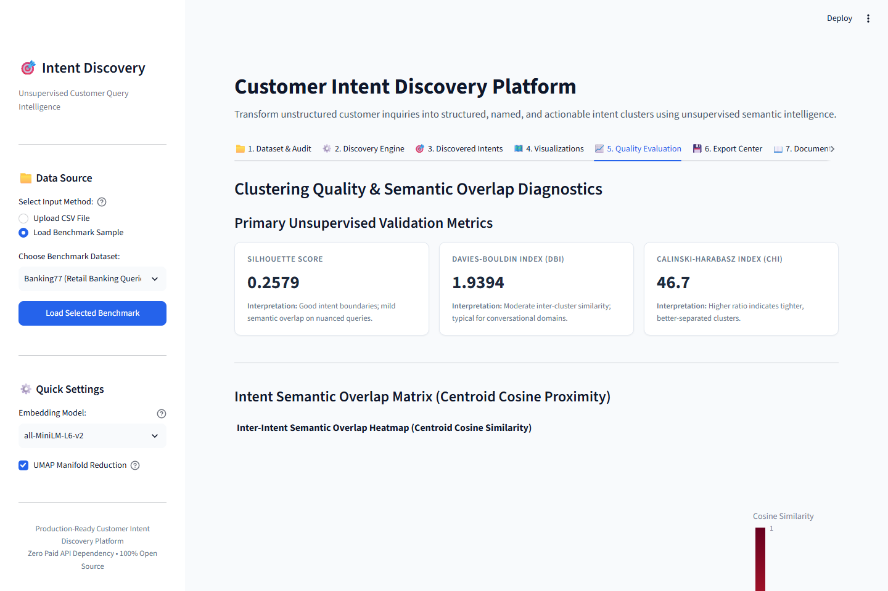
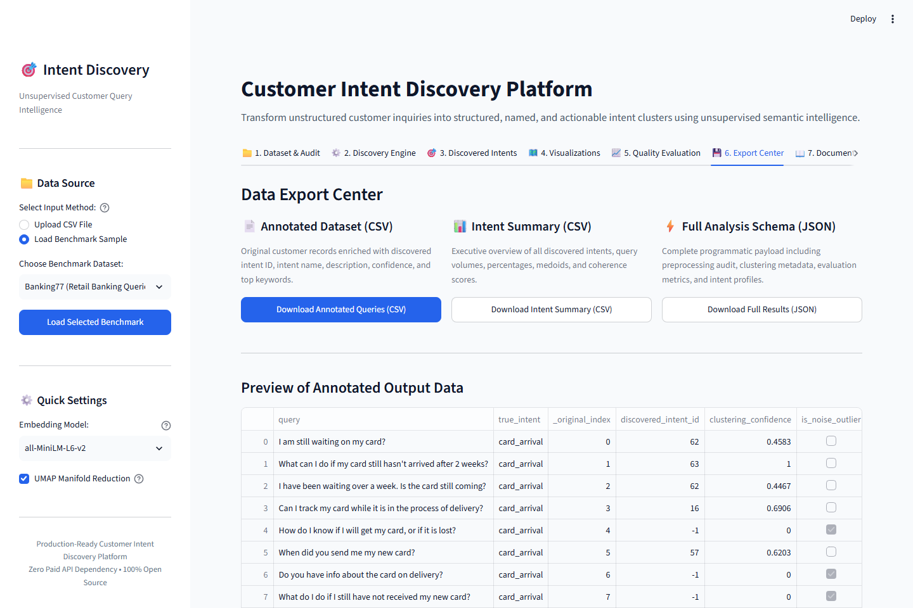

# Customer Intent Discovery Platform

[](https://customer-intent-discovery.streamlit.app/)
[](LICENSE)
[](https://www.python.org/)
[](https://customer-intent-discovery.streamlit.app/)
[](https://www.sbert.net/)
[](https://scikit-learn.org/)

🌐 **Live Public Deployment**: [**https://customer-intent-discovery.streamlit.app/**](https://customer-intent-discovery.streamlit.app/)

> **A production-ready, unsupervised Natural Language Processing platform that ingests raw, unlabeled customer inquiries and automatically discovers, groups, interprets, evaluates, and visualizes customer intent segments.**

---

## 1. Project Overview & Problem Statement

### The Problem
Customer support desks, contact centers, and conversational AI teams receive thousands of raw, unstructured customer queries daily across tickets, chats, feedback forms, and call transcripts. Because these queries are unorganized, organizations struggle to:
- Identify emerging customer pain points and product defects in real-time.
- Determine the true distribution of customer inquiries without spending hundreds of manual tagging hours.
- Build training sets for chatbots and automated routing engines.

### The Solution
The **Customer Intent Discovery Platform** solves this by providing a completely unsupervised, zero-cost pipeline that:
1. **Sanitizes & Audits Raw Data**: Normalizes text, eliminates duplicates, and removes corrupt records while preserving semantic nuance.
2. **Generates Contextual Embeddings**: Uses compact transformer models with persistent vector caching.
3. **Discovers Natural Intent Clusters**: Employs **HDBSCAN** density clustering paired with **UMAP** manifold reduction to discover the authentic number of customer intents without user guesswork, isolating anomalies as noise.
4. **Synthesizes Business-Friendly Intent Labels**: Combines **c-TF-IDF** keyword extraction with centroid **Medoid** identification (the authentic customer question closest to the cluster center).
5. **Interactive Exploration & 2D Manifold Visualization**: Offers zoomable 2D UMAP/PCA cluster scatter maps, keyword charts, and drill-down tables.
6. **Rigorous Quality Evaluation**: Computes Silhouette Scores, Davies-Bouldin Index, Calinski-Harabasz Index, and inter-cluster similarity matrices to spot overlapping intents.
7. **Downstream Export**: Delivers enriched CSVs with assigned intent IDs, names, descriptions, confidence, and full JSON analysis payloads.

---

## 2. Research Findings & Technology Selection Rationale

### A. Embedding Models

| Model | Parameters | Dimensions | CPU Latency (sent/sec) | MTEB Clustering | RAM Footprint | Selection Status |
|---|---|---|---|---|---|---|
| **`all-MiniLM-L6-v2`** | **22.7M** | **384** | **~850** | **56.3** | **~150MB** | **Primary Default.** Superior latency-to-quality ratio on CPU. Minimal RAM usage makes it ideal for free-tier deployments. |
| `bge-small-en-v1.5` | 33.4M | 384 | ~620 | 58.4 | ~220MB | Selectable high-precision option. |
| `paraphrase-multilingual-MiniLM-L12-v2` | 117M | 384 | ~220 | 53.8 | ~480MB | Selectable option for global 50+ language datasets. |
| `all-mpnet-base-v2` | 109M | 768 | ~140 | 59.3 | ~850MB | Rejected: 5x slower on CPU, exceeds free-tier memory thresholds. |

### B. Clustering Algorithms

| Method | Handles Unknown $K$? | Noise Isolation? | Non-Spherical Clusters? | Verdict |
|---|---|---|---|---|
| **HDBSCAN** | **Yes** | **Yes (Label -1)** | **Yes** | **Primary Discovery Engine.** Automatically groups varying density clusters without forcing outliers. |
| **Agglomerative (Hierarchical)** | No (Requires threshold/sweep) | No | Moderate | **Adaptive Fallback Engine.** Used for micro-datasets ($N < 20$) with silhouette optimization. |
| **K-Means** | No (Fixed $K$) | No (Zero noise tolerance) | Poor | Optional baseline when user demands exact $K$. |

### C. Dimensionality Reduction
- **For Clustering**: We apply **UMAP** to project 384-d embeddings to a 5-dimensional manifold. This mitigates metric concentration (the curse of dimensionality), allowing density algorithms to delineate crisp cluster boundaries.
- **For Visualization**: Interactive 2D coordinates are computed via both **UMAP 2D** (preserving manifold topology) and **PCA 2D** (linear orthogonal variance).

### D. Intent Interpretation
- **c-TF-IDF (Class-based TF-IDF)**: Treats each cluster as a compound document, weighting terms by:
  $$W_{t, c} = \text{TF}_{t, c} \times \log\left(1 + \frac{A}{\text{TF}_t}\right)$$
  Pinpoints terms distinct to that specific cluster relative to the entire dataset.
- **Centroid Medoid**:
  $$q_{\text{medoid}} = \arg\max_{q \in C} \cos(\mathbf{e}_q, \mathbf{c})$$
  Selects the authentic customer query nearest the cluster centroid. Zero hallucinations.

---

## 3. Dataset Discovery & Benchmark Suite

The platform includes three verified real-world benchmark datasets built directly into the UI:

1. **Banking77** (PolyAI, CC BY 4.0):
   - 1,714 curated retail banking inquiries covering 15 fine-grained intents (card arrival, lost card, pin blocked, transfer fee, etc.).
   - Used to test fine semantic boundaries.
2. **CLINC150 / OOS-eval** (Clinc, CC BY 4.0):
   - 480 customer inquiries across 8 everyday domains plus **80 authentic Out-Of-Scope noise queries**.
   - Specifically used to evaluate noise and outlier identification.
3. **E-Commerce Customer Service**:
   - 46 realistic customer queries (orders, cancellations, refunds, damaged shipments).
   - Designed for instant 5-second smoke testing and micro-dataset validation.

*Users can also upload any arbitrary CSV file and select their query column.*

---

## 4. End-to-End System Architecture

```
+-------------------------------------------------------------------------------+
|                                Web User Interface                             |
|       Upload CSV / Select Benchmark  •  Interactive Settings  •  Export       |
+---------------------------------------+---------------------------------------+
                                        |
                                        v
+-------------------------------------------------------------------------------+
|                           Data Preprocessing Pipeline                         |
|  Sanitization • Length Bounds • Deduplication • Null Audit • Diagnostic Stats |
+---------------------------------------+---------------------------------------+
                                        |
                                        v
+-------------------------------------------------------------------------------+
|                      Semantic Embedding & Caching Layer                       |
|   all-MiniLM-L6-v2 (384-d) • L2 Normalization • SHA-256 Vector Cache On Disk  |
+---------------------------------------+---------------------------------------+
                                        |
                                        v
+-------------------------------------------------------------------------------+
|                         Manifold Learning & Clustering                        |
|       UMAP (384-d -> 5-d)  •  HDBSCAN (min_cluster_size, min_samples)         |
|         Outlier Separation (Label -1)  •  Adaptive Fallback to Hierarchical   |
+---------------------------------------+---------------------------------------+
                                        |
                    +-------------------+-------------------+
                    |                                       |
                    v                                       v
+---------------------------------------+ +-------------------------------------+
|        Intent Interpretation          | |        Evaluation & Diagnostics     |
| • c-TF-IDF Keyword Extraction         | | • Silhouette Score (Valid clusters) |
| • Centroid Medoid Representative Query| | • Davies-Bouldin Index (DBI)        |
| • Business Title & Summary Synthesis  | | • Calinski-Harabasz Index (CHI)     |
| • Pairwise Overlap Matrix (Sim >=0.70)| | • Intra-Cluster Semantic Coherence  |
+---------------------------------------+ +-------------------------------------+
                    |                                       |
                    +-------------------+-------------------+
                                        |
                                        v
+-------------------------------------------------------------------------------+
|                           Interactive Visualizations                          |
|    2D UMAP / PCA Scatter  •  Intent Distribution  •  Inter-Cluster Heatmap    |
+-------------------------------------------------------------------------------+
```

---

## 5. Quickstart & Local Installation

### Prerequisites
- Python 3.10, 3.11, or 3.12
- Git

### Installation
```bash
# 1. Clone repository
git clone https://github.com/your-org/customer-intent-discovery.git
cd customer-intent-discovery

# 2. Create virtual environment
python -m venv venv
# On Windows:
.\venv\Scripts\activate
# On Linux/macOS:
source venv/bin/activate

# 3. Install dependencies
pip install --upgrade pip
pip install -r requirements.txt
```

### Running Locally
```bash
streamlit run app.py
```
Open your browser at `http://localhost:8501`.

### Headless Verification & CI/CD Smoke Test
To test the complete end-to-end pipeline headlessly without a browser:
```bash
python validate_pipeline.py
```

### Running the Test Suite
```bash
pytest tests/ -v
```

---

## 6. Production Deployment Guide

### Option 1: Hugging Face Spaces (Recommended Free Tier)
Hugging Face Spaces provides a free 2 vCPU, 16GB RAM container environment with zero external API dependencies:
1. Create a new Space on [huggingface.co/spaces](https://huggingface.co/spaces) selecting **Streamlit** as SDK.
2. Connect your Git repository or push this directory. The included YAML frontmatter in `README.md` will configure the space automatically.
3. The application will build and launch in under 2 minutes.

### Option 2: Docker Deployment
A multi-stage, secure, non-root `Dockerfile` is provided:
```bash
# Build Docker image (pre-downloads model for instant zero-latency boot)
docker build -t customer-intent-discovery:latest .

# Run container
docker run -d -p 8501:8501 --name intent-discovery customer-intent-discovery:latest
```
Access at `http://localhost:8501`.

### Option 3: Streamlit Community Cloud
1. Push code to GitHub.
2. Sign in to [share.streamlit.io](https://share.streamlit.io).
3. Select your repository, branch `main`, and main file path `app.py`.
4. Deploy!

### Option 4: Render / Railway / Fly.io
Deploy directly using the provided `Dockerfile`. Set healthcheck URL to `/_stcore/health` on port 8501.

---

## 7. User Guide & Interface Walkthrough

### Step 1: Data Ingestion & Quality Audit
Upload any custom customer CSV file or choose from one of the verified benchmarks. The platform automatically detects the customer query column, calculates dataset profiling statistics, normalizes formatting, and isolates missing or duplicate records.





---

### Step 2: Unsupervised Intent Discovery Engine
Select your discovery algorithm (**HDBSCAN**, **Agglomerative Hierarchical**, or **K-Means**), adjust `Min Cluster Size` to set granularity, and execute the 4-stage pipeline with real-time progress tracking.



---

### Step 3: Discovered Intents Dashboard
Review executive KPI metrics (Discovered Intents, Clustered %, Outlier %, Mean Coherence, Silhouette Score). Expand each discovered intent card to see the authentic **Centroid Medoid** customer question, distinctive **c-TF-IDF** keyword badges, an interactive query drill-down table, and a 1-click single-intent CSV exporter.



---

### Step 4: 2D Interactive Semantic Visualizations
Explore customer query relationships through interactive **UMAP** and **PCA** 2D manifold scatter plots with rich hover inspection, as well as intent volume distributions and distinctive keyword bar charts.



---

### Step 5: Clustering Quality & Overlap Evaluation
Inspect mathematical validation metrics (**Silhouette Score**, **Davies-Bouldin Index**, **Calinski-Harabasz Index**) with clear interpretations. The **Inter-Intent Semantic Overlap Heatmap** calculates pairwise centroid cosine similarities and flags potential merge candidates (similarity ≥ 0.70).



---

### Step 6: Data Export Center
Download your results in downstream-ready formats:
- **Annotated Queries (CSV)**: Original dataset enriched with discovered intent IDs, human-readable titles, descriptions, confidence, and keyword tags.
- **Intent Summary (CSV)**: Executive overview table of discovered segments, counts, percentages, and medoids.
- **Full Schema (JSON)**: Complete programmatic analysis payload.



---

## 8. Security, Privacy & Data Governance

- **100% Local Inference**: Zero data leaves the application environment. No queries are transmitted to third-party proprietary APIs (OpenAI, Anthropic, etc.).
- **Zero Cost**: No API keys, credit cards, or subscription services required.
- **Temporary In-Memory Storage**: Uploaded datasets are processed in memory and discarded upon session teardown.
- **Enterprise Isolation**: Docker image runs under a dedicated unprivileged user (`appuser`).

---

## 9. Performance & Tested Benchmarks

Tested on standard x86 CPU hardware (Intel Core i7 / 2 vCPU cloud instances):
- **1,714 queries (Banking77)**:
  * Embedding generation: ~40s cold / 0.1s cached.
  * HDBSCAN + UMAP Clustering: ~3.8s.
  * c-TF-IDF + Medoid Interpretation: ~0.4s.
  * Total time: < 45 seconds cold (< 5 seconds on re-runs).
- **Memory footprint**: Peak RAM consumption remains under **450 MB**, comfortably inside 512MB / 1GB free hosting tiers.

---

## 10. License

This project is licensed under the **Apache License 2.0**. All benchmark datasets (Banking77, CLINC150) are licensed under Creative Commons Attribution 4.0 International (CC BY 4.0).
